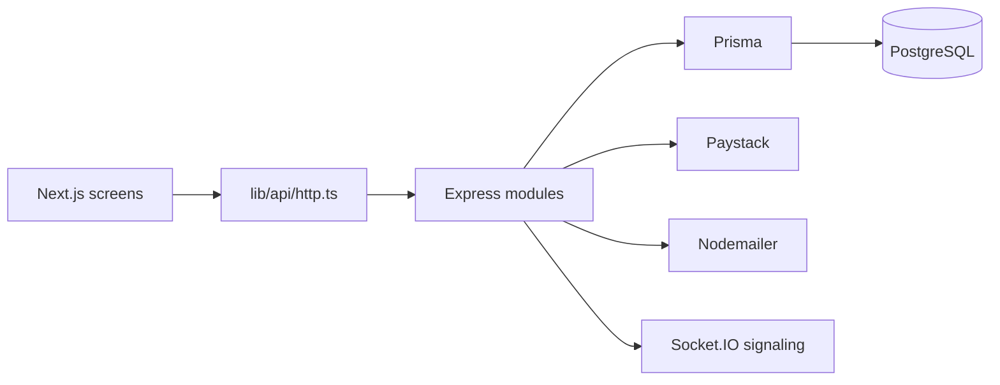

# System architecture

The API is one Express process behind Render's proxy. Express trusts one proxy hop so client addresses and HTTPS are taken from `X-Forwarded-For` and `X-Forwarded-Proto`. Cloudflare's `CF-Connecting-IP` is the rate-limit key when that header is present. Route ownership lives in `src/services` and `src/routes`: auth, appointments, payments, encounters, and operations. They share Prisma, the audit helper, and the error envelope. A service can be split out later because it talks to other areas through Prisma models and HTTP, not through another service's private helpers.

`GET /api/session/workspace` uses the same visibility rules as the list routes and returns one `AppState` snapshot. The browser keeps that snapshot in memory. Mutations call one endpoint and then reload the snapshot.

PostgreSQL holds users, clinical records, documents, the medicine catalogue, and the desk ledger. Production startup runs `prisma migrate deploy` before it accepts requests. An empty database then receives the department catalog, hospital fees, and preview staff. Startup opens Prisma with the `DATABASE_URL` value loaded from `.env` and logs that host. `PGHOST`, `PGUSER`, `PGPORT`, and `PGDATABASE` remain available for `npm run db:azure`, which rewrites `DATABASE_URL`; the running API does not connect through those variables. Clinical encounters, allergies, medication administrations, and payments are not deleted. Staff, departments, and inventory use `deletedAt` when a record must leave active lists.

Jobs use BullMQ only when `REDIS_URL` is present. Otherwise the in-process queue runs the same job names. SMS, Azure Blob, and an external log platform are interfaces with no live calls. Video tokens are HMAC values. Consultation calls use one Socket.IO server on the API process for signaling and WebRTC in the browser for audio and video. A patient may rate that visit after the call ends. Desk officers 2 and 3 collect pharmacy, laboratory, and scan work only for physical visits. TURN credentials stay in the environment and are returned only to a signed-in caller.
